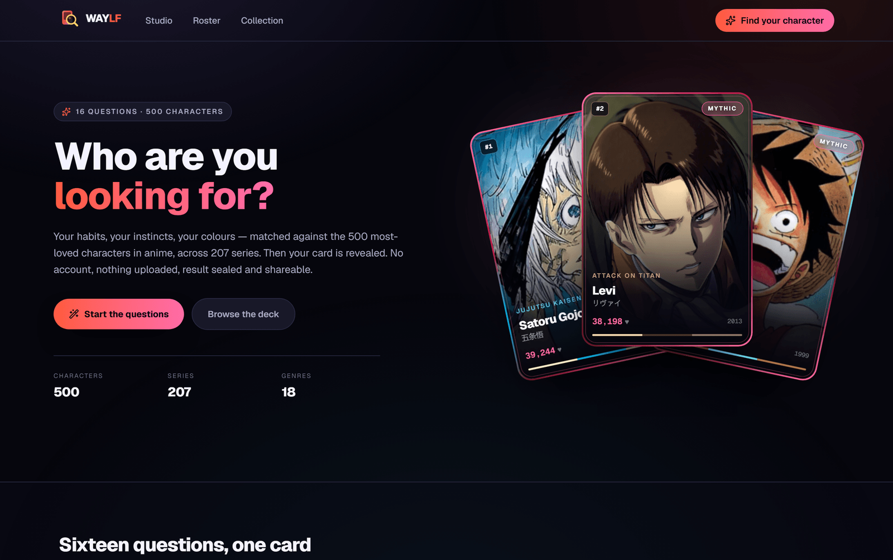
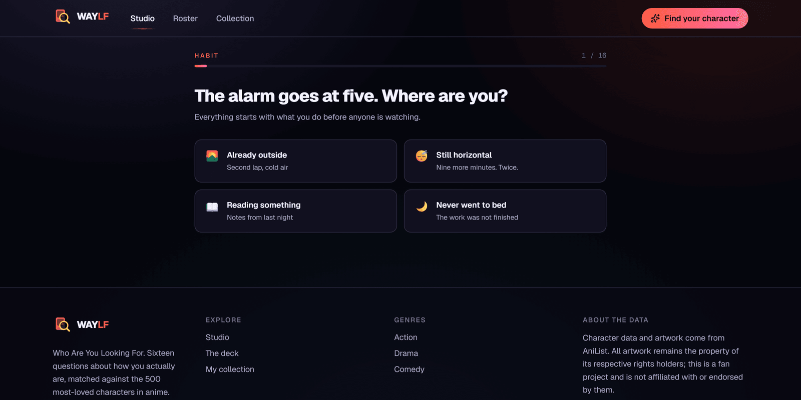
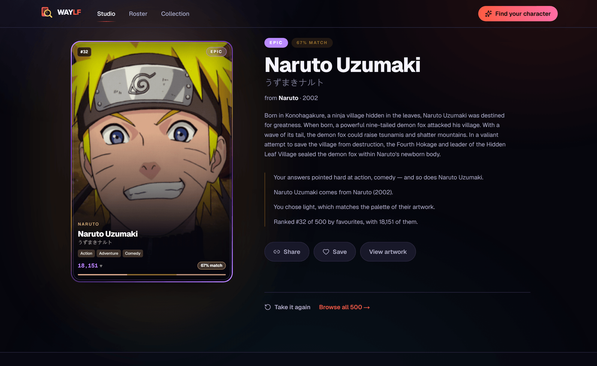
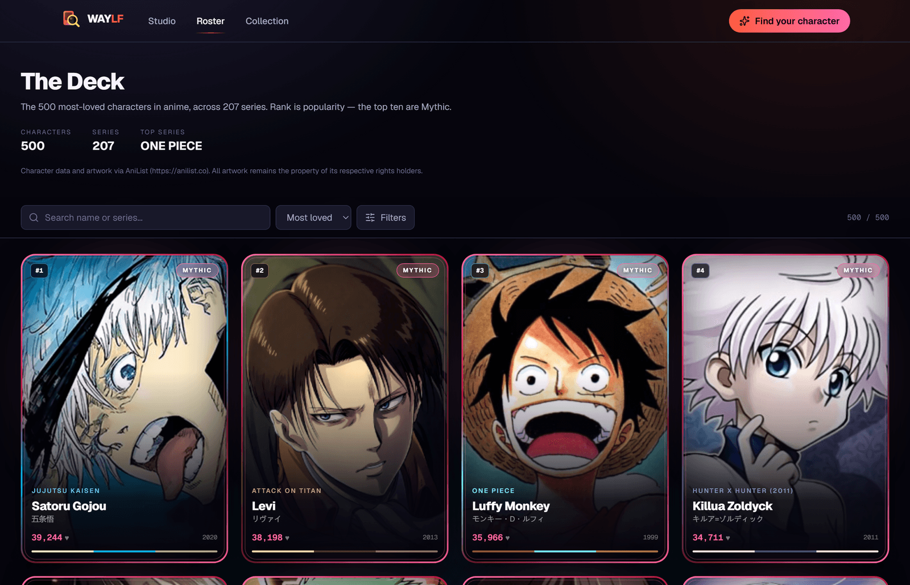

<div align="center">

# WAYLF

### Who Are You Looking For

**Sixteen questions about your habits, instincts and colours — matched against the 500 most‑loved characters in anime, revealed as a premium collectible card.**

<br/>

[](https://nextjs.org)
[](https://react.dev)
[](https://www.typescriptlang.org)
[](https://tailwindcss.com)
[](#-encryption)
[](#-no-keys-no-cost)

<br/>



</div>

<br/>

## What it is

Most "which character are you" quizzes have about twelve outcomes and a lookup table someone wrote in an afternoon. WAYLF scores **all 500 characters** against your answers on the server, using real data: AniList genres, theme tags, popularity, and a colour palette extracted from each character's own artwork.

The result arrives as a premium card with a staged reveal, a rarity tier earned from genuine popularity, and an explanation of *why* it chose you. Then it seals into a shareable link that cannot be forged.

<br/>

<table>
<tr>
<td width="50%" valign="top">

### 🎯 Real matching, not a lookup table

Every one of the 500 is scored on genre affinity, theme tags, palette distance, artwork brightness and popularity band. Opposite answers genuinely produce opposite characters.

</td>
<td width="50%" valign="top">

### 🎨 Colour matched from actual art

AniList has no hair‑colour field, so the build step reads each portrait's pixels and stores its three dominant tones. Gojo's palette really does come back cyan.

</td>
</tr>
<tr>
<td width="50%" valign="top">

### 🔒 Sealed, unforgeable results

Results are encrypted with AES‑256‑GCM before leaving the server. Edit a share link and it stops opening — you cannot promote yourself to Mythic.

</td>
<td width="50%" valign="top">

### ⚡ No keys, no cost, no queue

The deck is prebuilt from a free public API. No account, no model, no credits, no render wait. Answers in, card out.

</td>
</tr>
</table>

<br/>

## 📸 Screenshots

### The questionnaire

Sixteen questions across habits, instincts, taste and colour. One screen each, with a progress rail — no scrolling form, no "submit" button.



<br/>

### The reveal

A charge, a burst of light in the character's own colours, then the card lands. Alongside it: rarity, match strength, series, and the reasons your answers pointed here.



<br/>

### The deck

All 500, ranked by favourites. Filter by genre and tier, sort four ways, search by name or series. Rank is popularity — the top ten are Mythic.



<br/>

## 🚀 Quick start

```bash
npm install
npm run deck      # fetch the 500 characters (~5 min, no key needed)
npm run dev       # → http://localhost:3000
```

That's it. No `.env` needed to run locally.

| Script | What it does |
| :--- | :--- |
| `npm run deck` | Rebuild the 500‑character deck from AniList |
| `npm run dev` | Dev server |
| `npm run build` | Production build |
| `npm start` | Serve the production build |
| `npm run lint` | ESLint |
| `npm run typecheck` | `next typegen && tsc --noEmit` |

> **Before deploying,** set `QUIZ_SECRET` in `.env.local`. Without it the app falls back to a public development key and share links become forgeable. Generate one with:
> ```bash
> node -e "console.log(require('crypto').randomBytes(32).toString('base64url'))"
> ```

<br/>

## 🧭 How it works

```
 intro ──► 16 questions ──► POST /api/quiz ──► sealed token ──► staged reveal
                                  │
                                  ├─ genre + tag weights
                                  ├─ palette distance
                                  ├─ brightness match
                                  └─ popularity band
                                  ▼
                        all 500 scored, best wins
```

**The app never opens on a character.** It opens on the questions. A card you were handed is a lookup; a card that came out of your own answers is a result.

### What each answer feeds

| You answer about… | It feeds… |
| :--- | :--- |
| Conflict, drive, pace, stakes | AniList **genre** weights |
| Weapon, training ground, company | **Theme‑tag** weights — Swordplay, Rivalry, Magic, Assassin |
| Two colour picks | **Palette distance** to the character's extracted tones |
| Light or shadow | Artwork **brightness** |
| Adventurous answers | How **deep into the deck** to look |

### It actually discriminates

Five opposite answer profiles, five genuinely different results:

| Answer profile | Match | Tier |
| :--- | :--- | :--- |
| mecha · tech · future | **Shinji Ikari** — *Neon Genesis Evangelion* | Rare |
| blade · stoic · tragedy | **Akame** — *Akame ga Kill!* | Uncommon |
| dark · alone · tense | **Ray** — *The Promised Neverland* | Rare |
| sports · crew · funny | **Naruto Uzumaki** — *Naruto* | Epic |
| music · warm · slow | **Aira Shiratori** — *DAN DA DAN* | Uncommon |

### Rarity is earned, not assigned

Tiers derive from popularity rank, so they are never stored and never hand‑picked. Refresh the deck and everything re‑tiers itself.

| Tier | Rank | Example |
| :--- | :--- | :--- |
| 🔴 **Mythic** | Top 10 | Satoru Gojou, Levi, Luffy |
| 🟡 **Legendary** | 11–30 | — |
| 🟣 **Epic** | 31–70 | Naruto Uzumaki |
| 🔵 **Rare** | 71–150 | Shinji Ikari |
| 🟢 **Uncommon** | 151–300 | Akame |
| ⚪ **Common** | 301–500 | — |

### The match percentage means something

Affinity is the winner's margin over the **90th percentile** of the field — not a raw score.

Two earlier formulas pinned at 99 % for every result. An absolute score saturates immediately, and comparing against the mean does not help either, because the floor is full of zero‑overlap characters that stretch the denominator until every winner looks equally dominant. Comparing against the *top* of the field asks the right question: how much better than the next‑best candidates is this one? Real results now land between 62 % and 85 %.

<br/>

## 🔑 No keys, no cost

The deck is built ahead of time by `npm run deck`, which pulls from **AniList's public GraphQL API** — free, unauthenticated, no account. Nothing is generated at request time, so there is no model, no credential and no per‑result spend.

`data/characters.json` holds **metadata only** — names, series, genres, favourites, and the extracted palette. It is 492 KB. Artwork is **hot‑linked from AniList's CDN** and never copied into this repository.

### Why portrait cards, not full‑body art

AniList standardises every character image to **230 × 345** — a portrait crop. A sample of 25 found a median aspect of 1.5 and **zero** images taller than 1.6. The CDN has no larger variant: `/original/` and `/full/` both 404. MyAnimeList is the same shape, because character databases serve headshots — that is what their own UIs need.

So the card is designed *for* a portrait rather than fighting one: full‑bleed artwork at exactly 2:3, face in the upper two thirds, type laid over a scrim below.

Real licensed characters, full‑body posed art, and zero cost cannot all be true at once. Full‑body art would mean generating it — which costs money and, for an existing character, would mean creating a derivative work of a protected design.

<br/>

## 🔐 Encryption

Two separate concerns, both real.

**The scoring table never reaches the browser.** `lib/quiz/questions.ts` ships because the questions must be displayed. `lib/quiz/match.ts` — which answers favour which genres, tags and characters — is marked `import "server-only"`, making a client import a *build error*.

Verified against the production bundle:

| String | Client chunks |
| :--- | :--- |
| `"The alarm goes at five"` (a question — must ship) | **1** ✅ |
| `matchCharacter` | **0** ✅ |
| `colourDistance` | **0** ✅ |
| genre weights (`Shounen: 2`) | **0** ✅ |
| `aes-256-gcm` | **0** ✅ |

**Results are sealed with AES‑256‑GCM.** The token in a share URL is encrypted *and authenticated*, so a tampered token fails to open rather than decoding into something attacker‑chosen. That is what stops someone editing their link to claim a Mythic.

```
valid token    → Naruto Uzumaki / epic / 67 %
tampered token → "That result link is invalid or has been altered."
```

> This does **not** hide the card on screen — the client must receive it to draw it. The encryption is about forgery and protecting the outcome table.

<br/>

## 📁 Project layout

```
app/
  page.tsx              landing
  studio/               the questionnaire + reveal
  roster/               the 500-card deck browser
  collection/           saved characters
  api/quiz/             scoring + sealed tokens
components/
  quiz/                 flow, staged reveal
  deck/                 the premium card
  roster/ collection/ shell/
lib/
  deck.ts               the 500, rarity by rank
  quiz/questions.ts     client-safe questions
  quiz/match.ts         server-only scoring  ← never bundled
  quiz/seal.ts          AES-256-GCM
  color.ts rng.ts rarity.ts collection.ts
data/characters.json    the deck (metadata only, 492 KB)
scripts/
  fetch-characters.mjs  AniList fetch + palette extraction
docs/screenshots/
```

<br/>

## 🛠 Implementation notes

<details>
<summary><strong>Palette extraction</strong></summary>

<br/>

`npm run deck` downloads each portrait, resizes to 48×48, and buckets pixels into a coarse RGB grid. The busiest buckets win. Near‑white and near‑black are discarded — almost every portrait is mostly background and line art, and without that filter every character returns "grey".

Mean luminance is stored alongside, which is what the light/shadow question scores against.

</details>

<details>
<summary><strong>Description cleaning</strong></summary>

<br/>

AniList descriptions arrive as markdown with spoiler markup, inline links and a leading spec block:

```
__Height:__ 190 cm (6'3")
__Occupation:__ Jujutsu Sorcerer, Teacher

Satoru Gojou is one of the main protagonists…
```

Links are unwrapped to their label text (otherwise cards render raw `[nine-tailed demon fox](https://…)`), and the spec block is stripped so blurbs start at actual prose. The value pattern has to allow spaces — an earlier `\S{0,40}` version matched nothing, because every real value contains one.

</details>

<details>
<summary><strong>Determinism</strong></summary>

<br/>

Matching is deterministic: identical answers always return the same character, so a shared result stays stable and a retake is honest rather than a fresh roll. A tiny seeded jitter breaks near‑ties, so the same few characters do not dominate every scattered answer set.

</details>

<details>
<summary><strong>Why webpack, not Turbopack</strong></summary>

<br/>

`dev` and `build` pass `--webpack`. Turbopack's native binary crashes with `Illegal instruction` (SIGILL) on the machine this was developed on — a CPU/binary compatibility issue, not an app problem.

If Turbopack runs fine on your machine, `npm run dev:turbo` and `npm run build:turbo` use it and are considerably faster.

</details>

<br/>

## ⚖️ Licensing & attribution

Character data and artwork come from **[AniList](https://anilist.co)**. All artwork remains the property of its respective studios and publishers.

This is a **fan project**, not affiliated with or endorsed by AniList or any rights holder. The arrangement — hot‑linking a public API's images with attribution — is the same one the wider AniList app ecosystem runs on, and is appropriate for a portfolio or fan project.

> **It is not cleared for commercial use.** Do not sell this or claim ownership of the artwork.

The application code is yours to do with as you like.

<br/>

<div align="center">

**WAYLF** — Who Are You Looking For

<sub>Built with Next.js · Character data &amp; images via AniList</sub>

</div>
